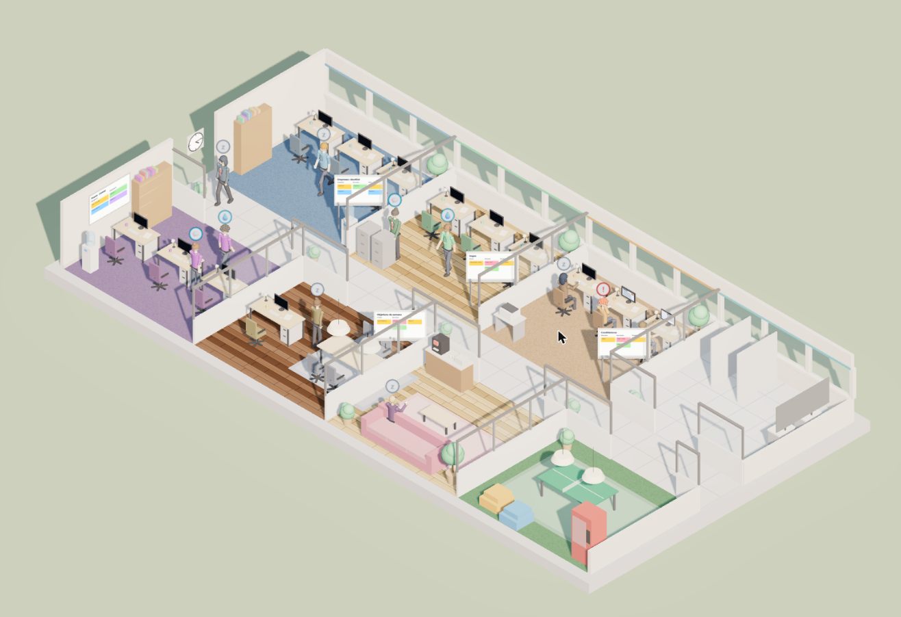
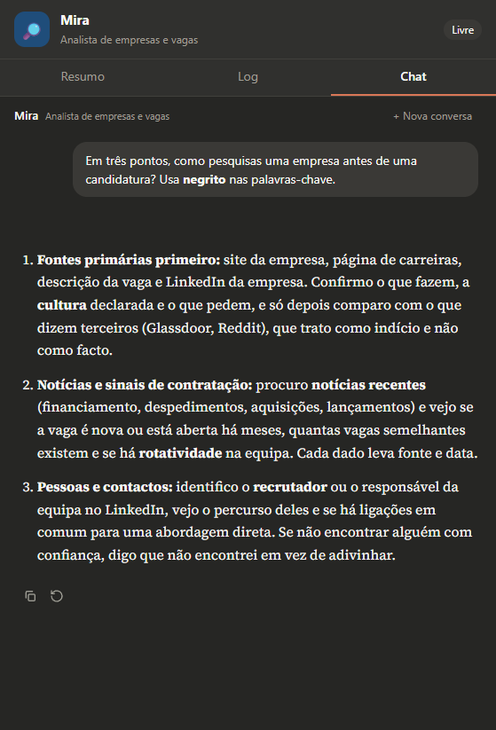
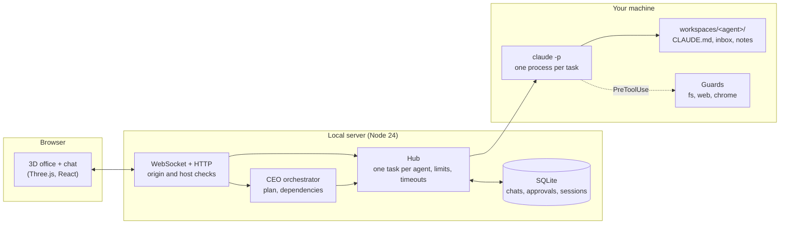

# Agent Office

> A 3D isometric office where **every person is a [Claude Code](https://docs.claude.com/en/docs/claude-code) agent**. Click a character to chat with it, give orders to the CEO and watch the team walk, sit, research and write.

[Português (pt-PT)](README.pt-PT.md) · **[Live demo](https://manuelportugalreis.com/agent-office/)** (the office and the city only: the agents work on your own machine, see below)



Agent Office turns a team of AI agents into something you can actually see. Eleven agents with their own roles, personalities, folders and memory work in a small office. You talk to them in a chat that looks and feels like Claude, or you give one order to the CEO and it plans the work and hands it out.

Everything runs **on your machine**, through the `claude` command-line tool and your own Claude login. There is no cloud service, no API key to paste and no account to create.

> **Status:** early (0.x). It is built around a job-search and study workflow, but the office is just data and prompts: fork it and change the team.

<p align="center"></p>

## Features

- **A living office.** Isometric 3D scene (Three.js) with a day/night cycle. Characters with faces, hair and badges sit at their desks, wash their hands, play table tennis, chat in the corridor, hold meetings, hand a paper to a colleague when the CEO delegates, and wave when they need your approval. Only idle people wander; anyone with a real task stays at the desk.
- **A cover letter you can trust.** Open a job-application dossier (📁 Dossier). Mira finds the original listing (or uses your link) and delivers a validated research brief: role, company, listing URL, date checked, mandatory vs desirable requirements, every fact tied to its source, and an explicit list of what could not be confirmed. If the vacancy is ambiguous or missing she asks you instead of guessing. Lena writes from that brief plus your shared profile and any facts you add, and keeps her questions out of the letter. Nina, an independent reviewer, checks the letter against the same research and evidence (an unsupported claim such as "led" where the profile says "contributed" blocks it, style tips don't), sends it back to Lena once with exact corrections, and only then does it reach your review tray. The folder travels across the office to each desk; click it, or the board in the Management room, to see where the facts came from, what Nina checked and which questions need your answer. Approve it or send it back to Lena with a note. The board in the Management room shows at a glance who has it and whether you need to act ("À tua espera"). Nothing is ever sent. It survives reloads and restarts.
- **Walk around.** Press `W` (or the 🚶 button) to get your own avatar: arrow keys along the corridor, click the floor or a person to walk to their desk (their chat opens when you arrive), `F` toggles the follow camera.
- **Chat that feels like Claude.** Streaming answers, Markdown, edit and regenerate the last message, stop, file attachments (`.md`, PDF, images, `.docx`), a new conversation at any time, `Ctrl+K` to jump to anyone and `@name` to hand a conversation to another agent.
- **Real agents, not mock-ups.** Each one is a separate Claude Code process with its own system prompt, tools, folder and memory (`CLAUDE.md`).
- **A CEO that delegates.** One order becomes a validated plan of up to three tasks, with dependencies: the writer waits for the researcher and receives her result. When the team finishes, the CEO summarises what was actually done.
- **Human in the loop.** Drafts land in an approval queue. Nothing is ever sent without you. With `vaultDir` set and the folder `01 Candidaturas/00 Aprovações` present, approving a draft also saves it there as a note (`enviado: não`); the server never creates folders in your vault.
- **Persistent.** Chats, logs, approvals and sessions survive restarts (SQLite).
- **Read-only Canvas sync (optional).** One agent reads your LMS dashboard through your own Chrome, only when you click, and only on the one domain you configure.
- **Your notes, optionally.** Set `vaultDir` to an Obsidian vault and file agents can read, create and edit notes there.
- **Defence in depth.** Guards are self-tested at startup (the server refuses to start if one fails open), per-agent file sandbox, URL guard for web tools, browser allow-list, local-only server. See [SECURITY.md](SECURITY.md).

## How it works



The server never talks to a model API. It starts `claude -p --output-format stream-json` per task, streams its events to the browser and stores the result. Details in [docs/architecture.md](docs/architecture.md).

## Requirements

- **Node.js 24 or newer** (uses `node:sqlite` and runs TypeScript directly).
- **Claude Code**, installed and logged in: run `claude` once in a terminal. See the [official docs](https://docs.claude.com/en/docs/claude-code).
- A Claude plan that allows Claude Code. Agents use your plan's quota (the CEO uses Opus, everyone else Sonnet).
- _Optional:_ Chrome with the Claude in Chrome extension, only for the Canvas sync.

## Quick start

```bash
git clone https://github.com/manuelportugalreis/agent-office.git
cd agent-office
npm install
npm run doctor      # checks Node, Claude Code, config and the port
npm start           # builds the interface and serves everything on http://127.0.0.1:8787
```

For development (hot reload on http://127.0.0.1:5174):

```bash
npm run dev
```

Click a person in the office, or press `Ctrl+K`, and start talking.

### For your friends

The GitHub Pages demo shows the office, but the agents do not run there: they run in the Claude Code of whoever has the
server on. To really use it, each person installs it on their own machine (Node 24 and Claude Code with their own
account):

```bash
git clone https://github.com/manuelportugalreis/agent-office.git
cd agent-office
npm install
npm start           # opens http://127.0.0.1:8787
```

To let the agents work on a project and in Obsidian like the terminal does, see [the local Claude Code mode](docs/claude-code-local.md) (in Portuguese).

## Configuration

Copy the example and edit it. The real file is git-ignored, so your name and courses never leave your machine.

```bash
cp office.config.example.json office.config.json
```

| Key            | What it does                                                                                                      |
| -------------- | ----------------------------------------------------------------------------------------------------------------- |
| `userName`     | How agents address you and the chat greeting. Empty means "the user".                                             |
| `port`         | Server port (default `8787`). Also `AGENT_OFFICE_PORT`.                                                           |
| `canvasHost`   | The **only** domain the Canvas agent may open in your browser.                                                    |
| `courses`      | Which agent handles which course (`agent`, `code`, `title`). The code must match what Canvas shows.               |
| `vaultDir`     | Optional folder (for example an Obsidian vault) where file agents may also read and write. Empty means no access. |
| `extraOrigins` | Extra origins allowed to talk to the server (for example a reverse proxy). Leave empty normally.                  |

Edit `server/workspaces/_company/perfil.md` (created on first run) to tell every agent about you. Agents can only read it.

## Using it

| Do this                       | To get this                                                      |
| ----------------------------- | ---------------------------------------------------------------- |
| Click a person                | Open their chat (Summary and Log tabs too)                       |
| `Ctrl+K`                      | Search and jump to any agent                                     |
| `@lena write the email`       | Hand the conversation to Lena, with the last answer as context   |
| Type in the bar at the bottom | Give an order to the CEO: he plans, delegates and the team works |
| Approvals button              | Review, copy, approve or reject drafts                           |
| **+ New conversation**        | Start a fresh chat. The agent keeps its memory file              |
| Drag the panel edge           | Make the chat wider                                              |

## The team

| Agent  | Role                             | Web | Files | Model  |
| ------ | -------------------------------- | :-: | :---: | ------ |
| Atlas  | CEO: plans and delegates         |     |       | Opus   |
| Rhea   | Head of research                 |  ✓  |   ✓   | Sonnet |
| Mira   | Company and job analyst          |  ✓  |   ✓   | Sonnet |
| Vera   | Head of job search               |  ✓  |   ✓   | Sonnet |
| Scout  | Collects and scores jobs         |  ✓  |   ✓   | Sonnet |
| Nina   | Head of applications, reviewer   |     |   ✓   | Sonnet |
| Lena   | Writes cover letters and emails  |     |   ✓   | Sonnet |
| Theo   | Prepares form answers            |     |   ✓   | Sonnet |
| Dean   | Reads the Canvas dashboard       |     |       | Sonnet |
| Ada    | Organises deliverables, course 1 |     |   ✓   | Sonnet |
| Turing | Organises deliverables, course 2 |     |   ✓   | Sonnet |

Nobody has a shell. Nobody can send email. See [docs/architecture.md](docs/architecture.md#adding-or-changing-an-agent) to change the team.

## Docker

```bash
docker compose up --build -d
docker compose exec office claude   # log in once (saved in a volume)
```

Open http://127.0.0.1:8787. The port is published on this machine only, because the server has no login. To use your Obsidian vault, uncomment the volumes in `docker-compose.yml`. The Canvas sync needs your Chrome, so it does not work from the container. The Docker setup has not been tested yet: use the normal install if something fails.

## Development

```bash
npm run check        # typecheck + lint + format check + tests + build
npm run e2e          # browser tests (first: npx playwright install chromium); no agents, no quota
npm test             # app and server tests
npm run typecheck
npm run lint
npm run format
```

```
app/      Vite + TypeScript: 3D scene, simulation, React chat
server/   Node: hub, orchestrator, SQLite store, guards, static files
shared/   The WebSocket protocol (one file used by both sides)
scripts/  dev launcher and `doctor`
docs/     architecture and screenshots
```

The simulation (`app/src/sim`), the hub, the orchestrator and every guard are plain TypeScript with tests that run without a browser or a model.

## Limitations

- **Approving does not send anything.** There is no email integration on purpose. You can copy the draft.
- **Editing and regenerating only work on the last exchange.** Claude Code cannot rewind a session, so the conversation is replayed into a fresh one.
- **Web agents can be tricked by hostile pages.** The URL guard reduces data exfiltration but cannot eliminate it. Do not put secrets in their folders. See [SECURITY.md](SECURITY.md).
- **The interface and the agents speak Portuguese (pt-PT)** by default. Translating means editing the prompts in `server/src/agents.ts` and the UI strings; there is no i18n layer yet.
- The Canvas sync reads your logged-in browser session and costs more quota than a normal chat.
- Local only. There is no authentication because the server only listens on `127.0.0.1`.

## Roadmap

- i18n for the interface and agent prompts
- Optional actions after approval (for example creating a Gmail draft) with explicit consent
- Define the team in a config file instead of code
- Per-agent cost and quota view
- End-to-end browser tests

## Disclaimer

Agent Office is an independent project. It is **not affiliated with, endorsed by or sponsored by Anthropic**. "Claude" and "Claude Code" are trademarks of Anthropic. You need your own Claude access and you are responsible for using Claude Code in line with [Anthropic's terms and usage policies](https://www.anthropic.com/legal).

## License

[MIT](LICENSE). Built with [Three.js](https://threejs.org), [React](https://react.dev), [assistant-ui](https://www.assistant-ui.com), [Vite](https://vitejs.dev), [ws](https://github.com/websockets/ws) and [Mammoth](https://github.com/mwilliamson/mammoth.js). The serif font is [Source Serif 4](https://github.com/adobe-fonts/source-serif) (SIL Open Font License).
