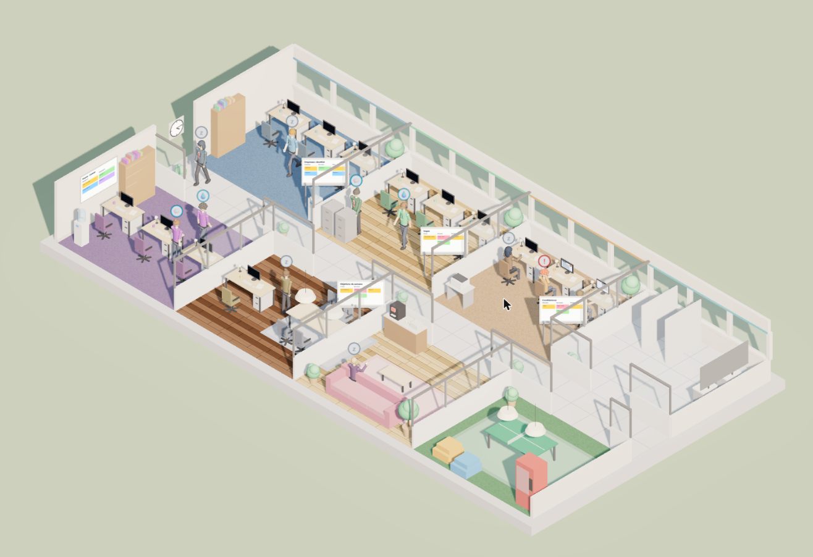
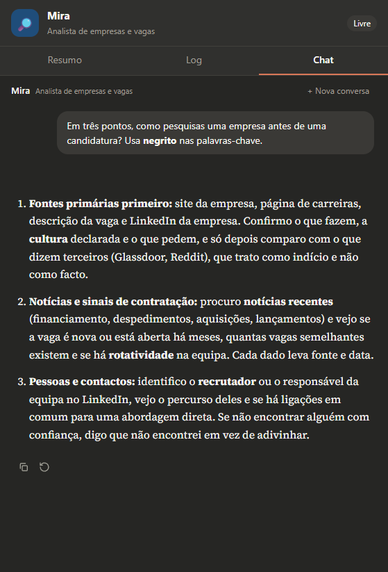

# Agent Office

> Um escritório 3D isométrico onde **cada pessoa é um agente [Claude Code](https://docs.claude.com/en/docs/claude-code)**. Clica numa personagem para falar com ela, dá ordens ao CEO e vê a equipa a andar, a sentar-se, a pesquisar e a escrever.

[English](README.md) · **[Demonstração](https://manuelportugalreis.com/agent-office/)** (só o escritório e a cidade: os agentes trabalham no teu computador, vê abaixo)



O Agent Office transforma uma equipa de agentes de IA em algo que se vê. Onze agentes, cada um com função, personalidade, pasta e memória próprias, trabalham num pequeno escritório. Falas com eles num chat que parece o do Claude, ou dás uma só ordem ao CEO, que planeia o trabalho e o distribui.

Tudo corre **no teu computador**, através da ferramenta `claude` e do teu próprio login do Claude. Não há serviço na nuvem, nem chave de API para colar, nem conta para criar.

> **Estado:** inicial (0.x). Foi pensado para procura de emprego e estudo, mas o escritório são só dados e prompts: faz um fork e muda a equipa.

<p align="center"></p>

## Funcionalidades

- **Um escritório vivo.** Cena 3D isométrica (Three.js) com ciclo dia/noite. As personagens (com rosto, cabelo e crachá) sentam-se, lavam as mãos, jogam ténis de mesa, conversam no corredor, fazem reuniões, entregam um papel a um colega quando o CEO delega e acenam quando precisam da tua aprovação. Só quem está livre passeia; quem tem uma tarefa real fica na secretária.
- **Uma carta em que podes confiar.** Abre um dossier de candidatura (📁 Dossier). A Mira encontra o anúncio original (ou usa o teu link) e entrega um resumo de pesquisa validado: cargo, empresa, URL do anúncio, data em que o viu, requisitos obrigatórios e desejáveis, cada facto ligado à sua fonte e a lista do que não conseguiu confirmar. Se a vaga é ambígua ou não existe, pergunta-te em vez de adivinhar. A Lena escreve a partir desse resumo, do teu perfil partilhado e dos factos que acrescentares, e deixa as perguntas dela fora da carta. A Nina, revisora independente, verifica a carta contra a mesma pesquisa e a mesma evidência (uma afirmação sem sustento, como «liderei» onde o perfil diz «contribuí», bloqueia; sugestões de estilo não), devolve-a uma vez à Lena com correções exatas e só depois ela chega à tua bandeja. A pasta viaja pelo escritório; clica nela, ou no quadro da sala de Gestão, para ver de onde vêm os factos, o que a Nina verificou e que perguntas precisam da tua resposta. Aprova ou devolve à Lena com uma nota. O quadro da sala de Gestão mostra de relance quem a tem e se precisas de agir («À tua espera»). Nada é enviado. Sobrevive a recarregar a página e a reiniciar o servidor.
- **Anda pelo escritório.** Carrega em `W` (ou no botão 🚶) para teres o teu avatar: setas ao longo do corredor, clica no chão ou numa pessoa para ires à secretária dela (a conversa abre quando chegas) e `F` liga ou desliga a câmara que te segue.
- **Chat como o do Claude.** Respostas em streaming, Markdown, editar e regenerar a última mensagem, parar, anexos (`.md`, PDF, imagens, `.docx`), conversa nova quando quiseres, `Ctrl+K` para ir ter com qualquer um e `@nome` para passar a conversa a outro agente.
- **Agentes a sério.** Cada um é um processo do Claude Code com prompt, ferramentas, pasta e memória (`CLAUDE.md`) próprios.
- **Um CEO que delega.** Uma ordem vira um plano validado de até três tarefas, com dependências: quem escreve espera pela investigadora e recebe o resultado dela. No fim, o CEO resume o que a equipa fez de facto.
- **Tu decides.** Os rascunhos vão para uma fila de aprovações. Nada é enviado sem ti. Com `vaultDir` definido e a pasta `01 Candidaturas/00 Aprovações` presente, aprovar um rascunho guarda-o também aí como nota (`enviado: não`); o servidor nunca cria pastas no teu vault.
- **Persistente.** Conversas, registos, aprovações e sessões sobrevivem a reinícios (SQLite).
- **Sincronização do Canvas, só de leitura (opcional).** Um agente lê o painel da tua plataforma de ensino pelo teu Chrome, só quando carregas, e só no único domínio que configurares.
- **As tuas notas, opcional.** Define `vaultDir` com um vault do Obsidian e os agentes com ficheiros podem ler, criar e editar notas lá.
- **Defesa em profundidade.** Os guardas são testados no arranque (o servidor recusa-se a arrancar se algum falhar aberto), sandbox de ficheiros por agente, guarda de URLs para a web, lista de domínios permitidos no browser, servidor só local. Ver [SECURITY.md](SECURITY.md).

## Como funciona

O servidor nunca fala com uma API de modelos. Lança `claude -p --output-format stream-json` por tarefa, envia os eventos para o browser e guarda o resultado. O diagrama e os detalhes estão em [docs/architecture.md](docs/architecture.md).

## Requisitos

- **Node.js 24 ou mais recente** (usa `node:sqlite` e executa TypeScript diretamente).
- **Claude Code**, instalado e com sessão iniciada: corre `claude` uma vez num terminal. Ver a [documentação oficial](https://docs.claude.com/en/docs/claude-code).
- Um plano do Claude que permita o Claude Code. Os agentes gastam a quota do teu plano (o CEO usa Opus, os outros Sonnet).
- _Opcional:_ Chrome com a extensão Claude in Chrome, só para a sincronização do Canvas.

## Começar

```bash
git clone https://github.com/manuelportugalreis/agent-office.git
cd agent-office
npm install
npm run doctor      # verifica Node, Claude Code, configuração e porta
npm start           # compila a interface e serve tudo em http://127.0.0.1:8787
```

Para desenvolver (recarregamento automático em http://127.0.0.1:5174):

```bash
npm run dev
```

Clica numa pessoa do escritório, ou carrega em `Ctrl+K`, e começa a falar.

### Para os teus amigos

A demonstração no GitHub Pages mostra o escritório, mas os agentes não trabalham lá: correm no Claude Code de quem tem
o servidor ligado. Para usarem a sério, cada um instala no seu computador (precisa de Node 24 e do Claude Code com a
sua própria conta):

```bash
git clone https://github.com/manuelportugalreis/agent-office.git
cd agent-office
npm install
npm start           # abre http://127.0.0.1:8787
```

Para os agentes trabalharem num projeto e no Obsidian como no terminal, vê [o modo Claude Code local](docs/claude-code-local.md).

## Configuração

Copia o exemplo e edita-o. O ficheiro verdadeiro é ignorado pelo Git, por isso o teu nome e as tuas disciplinas nunca saem do teu computador.

```bash
cp office.config.example.json office.config.json
```

| Chave          | O que faz                                                                                                                 |
| -------------- | ------------------------------------------------------------------------------------------------------------------------- |
| `userName`     | Como os agentes te tratam e a saudação do chat. Vazio significa "o utilizador".                                           |
| `port`         | Porta do servidor (predefinição `8787`). Também `AGENT_OFFICE_PORT`.                                                      |
| `vaultDir`     | Pasta opcional (ex.: um vault do Obsidian) onde os agentes com ficheiros também podem ler e escrever. Vazio = sem acesso. |
| `canvasHost`   | O **único** domínio que o agente do Canvas pode abrir no teu browser.                                                     |
| `courses`      | Que agente trata de que disciplina (`agent`, `code`, `title`). O código tem de coincidir com o Canvas.                    |
| `extraOrigins` | Origens extra aceites pelo servidor (por exemplo, um proxy). Normalmente fica vazio.                                      |

Edita `server/workspaces/_company/perfil.md` (criado à primeira execução) para dizer a todos os agentes quem és. Os agentes só o leem.

## Usar

| Faz isto                    | Para isto                                                     |
| --------------------------- | ------------------------------------------------------------- |
| Clicar numa pessoa          | Abrir o chat dela (e os separadores Resumo e Log)             |
| `Ctrl+K`                    | Procurar e ir ter com qualquer agente                         |
| `@lena escreve o email`     | Passar a conversa à Lena, com a última resposta como contexto |
| Escrever na barra de baixo  | Dar uma ordem ao CEO: ele planeia, delega e a equipa trabalha |
| Botão Aprovações            | Rever, copiar, aprovar ou rejeitar rascunhos                  |
| **+ Nova conversa**         | Começar um chat novo. O agente mantém o ficheiro de memória   |
| Arrastar a margem do painel | Alargar o chat                                                |

Ninguém tem terminal. Ninguém pode enviar email. Para mudar a equipa vê [docs/architecture.md](docs/architecture.md#adding-or-changing-an-agent).

## Docker

```bash
docker compose up --build -d
docker compose exec office claude   # inicia sessão uma vez (fica guardada num volume)
```

Abre http://127.0.0.1:8787. A porta só fica aberta nesta máquina, porque o servidor não tem login. Para usar o teu vault do Obsidian, tira o comentário dos volumes em `docker-compose.yml`. A sincronização do Canvas precisa do teu Chrome, por isso não funciona a partir do contentor. A configuração Docker ainda não foi testada: usa a instalação normal se algo falhar.

## Desenvolvimento

```bash
npm run check        # typecheck + lint + formatação + testes + build
npm test
npm run typecheck
npm run lint
npm run format
```

## Limitações

- **Aprovar não envia nada.** Não há integração de email, de propósito. Podes copiar o rascunho.
- **Editar e regenerar só funcionam na última troca.** O Claude Code não consegue recuar numa sessão, por isso a conversa é repetida numa sessão nova.
- **Os agentes com web podem ser enganados por páginas hostis.** A guarda de URLs reduz a fuga de dados mas não a elimina. Não ponhas segredos nas pastas deles. Ver [SECURITY.md](SECURITY.md).
- **A interface e os agentes falam português (pt-PT)** por predefinição. Traduzir implica editar os prompts em `server/src/agents.ts` e os textos da interface; ainda não há camada de i18n.
- A sincronização do Canvas usa a sessão do teu browser e gasta mais quota do que um chat normal.
- Só local. Não há autenticação porque o servidor só escuta em `127.0.0.1`.

## Aviso

O Agent Office é um projeto independente. **Não é afiliado, apoiado nem patrocinado pela Anthropic.** "Claude" e "Claude Code" são marcas da Anthropic. Precisas do teu próprio acesso ao Claude e és responsável por usar o Claude Code de acordo com os [termos e políticas de utilização da Anthropic](https://www.anthropic.com/legal).

## Licença

[MIT](LICENSE). Feito com [Three.js](https://threejs.org), [React](https://react.dev), [assistant-ui](https://www.assistant-ui.com), [Vite](https://vitejs.dev), [ws](https://github.com/websockets/ws) e [Mammoth](https://github.com/mwilliamson/mammoth.js). A fonte serifada é a [Source Serif 4](https://github.com/adobe-fonts/source-serif) (SIL Open Font License).
